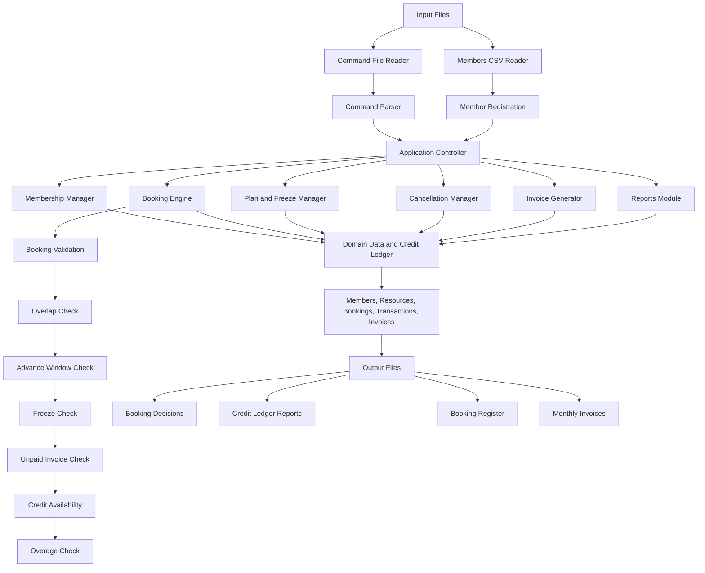
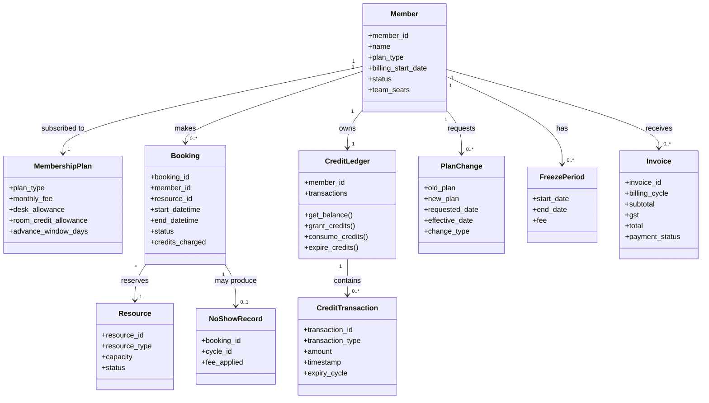
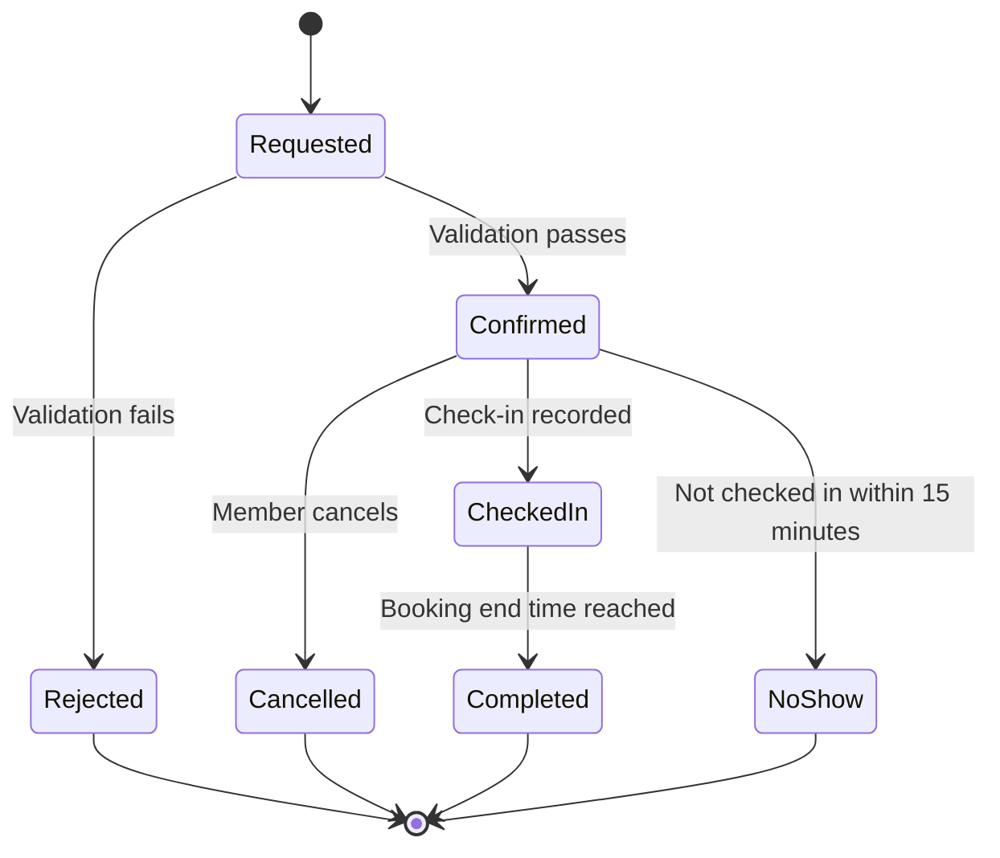
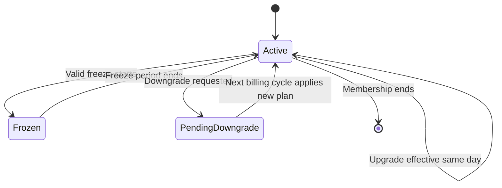
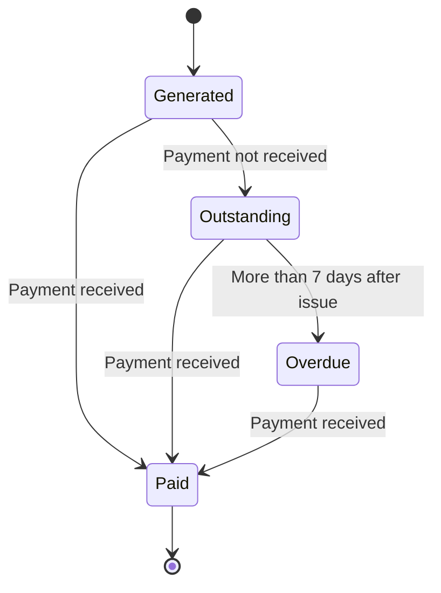

# T045 – PS-101
## Co-working Membership, Desk/Room Booking and Credit Ledger Engine
### Design Document – Version 1.0

**Team ID:** T045  
**Team Members:** Thanuja Madhu Chandre Gowda, Thoshin S  
**Language:** Python 3.10+  
**Application Type:** Command-file-driven backend engine 
**Status:** Initial design

---

## 1. Project Overview

The system is a backend engine for a co-working space operator. It manages member registration, membership plans, desk and meeting-room bookings, monthly credit allowances, credit transactions, membership changes, freezes, cancellations, no-shows, invoices and reports.

The application reads member information and commands from input files. It validates each command against the business rules, updates the relevant records and produces output files containing booking decisions, ledgers, booking registers and invoices.

### 1.1 Project objectives

- Register members under supported membership plans.
- Process desk and meeting-room booking requests.
- Apply booking validation in the specified precedence order.
- Calculate room credits using room type, time slots and applicable multipliers.
- Maintain an auditable credit ledger, including grants, consumption, carry-forward and expiry.
- Process plan changes, freezes, cancellations and no-shows.
- Generate monthly invoices with overages, fees, waivers, GST and applicable late interest.
- Produce member-specific reports.
---

## 2. Glossary

| Term | Meaning in this project |
|---|---|
| Member | A person or organization registered with the co-working operator. |
| Member ID | Unique identifier used to identify a member in commands and records. |
| DAY_PASS | Daily membership charged at ₹900 per day; it has no monthly credit allowance. |
| FLEX | Monthly plan costing ₹8,000, with 10 desk-days and 20 room credits. |
| DEDICATED | Monthly plan costing ₹15,000, with a fixed desk, unlimited desk usage and 40 room credits. |
| TEAM | Plan costing ₹12,000 per seat, with a minimum of three seats and 60 room credits per seat pooled for the team. |
| Hot desk | A shared desk allocated subject to availability. The hot-desk floor has 40 desks. |
| Dedicated desk | A desk assigned to a DEDICATED member and not released into shared hot-desk capacity. |
| Meeting room | A bookable room with a capacity category of 4, 8 or 20 seats. |
| Booking | A request/reservation for a resource over a date and time range. |
| Credit | A unit used to pay for meeting-room usage under eligible membership plans. |
| Desk-day | One day of hot-desk usage; for FLEX, the monthly allowance is 10 desk-days. |
| Credit ledger | A chronological record of credit grants, consumption, refunds, carry-forward and expiry. |
| Grant | Credits added to a member's allowance for a billing cycle. |
| Consumption | Credits deducted when an eligible booking is accepted/used, according to the implemented booking policy. |
| Carry-forward | Eligible unused room credits moved into the next billing cycle, subject to the cap and expiry rules. |
| FIFO | First In, First Out; older carried-forward credits are consumed before current-cycle credits. |
| Overage | A charge for eligible usage beyond the plan allowance. |
| Peak period | Weekday booking time touching 10:00–13:00, charged at 1.5 times the normal slot credits. |
| Weekend multiplier | Weekend bookings charged at 0.5 times normal slot credits. |
| Pro-rating | Calculating a partial-cycle fee or credit amount based on the relevant number of days. |
| Freeze | A temporary pause in membership during which bookings are not allowed and credits do not accrue. |
| Cancellation refund ladder | The percentage of consumed credits returned based on how long before the booking the cancellation occurs. |
| No-show | A booking for which the member does not check in within 15 minutes of its start time. |
| Invoice | A monthly bill containing membership fees, overages, fees, waivers, GST and applicable interest. |
| GST | Goods and Services Tax; the problem statement specifies 18%. |
| Validation precedence | The required order in which booking checks are performed; the first failed check determines the rejection reason. |
| Command file | A text file containing operations such as REGISTER, BOOK, CANCEL, UPGRADE, FREEZE, INVOICE and LEDGER. |

---

## 3. System Architecture

### 3.1 High-level architecture



### 3.2 Component responsibilities

| Component | Responsibility |
|---|---|
| Input Reader | Opens and reads CSV and command text files. |
| Command Parser | Splits each command into its operation and arguments and checks basic command structure. |
| Application Controller | Coordinates the execution of commands and calls the relevant service. |
| Member Manager | Registers members and retrieves member details. |
| Membership Manager | Holds plan definitions, fees, allowances and plan-related calculations. |
| Booking Engine | Creates and manages desk and room bookings. |
| Booking Validator | Executes the booking checks in the exact precedence order from the brief. |
| Credit Calculator | Calculates room credits by half-hour slot and applicable multiplier. |
| Credit Ledger | Records every credit transaction and supports FIFO consumption. |
| Plan and Freeze Manager | Processes upgrades, scheduled downgrades and freezes. |
| Cancellation Manager | Calculates refunds and handles no-show records and fees. |
| Invoice Generator | Calculates plan charges, overages, fees, waivers, GST and late interest. |
| Reports Module | Produces booking registers and member ledger reports. |
| Output Writer | Writes command decisions and reports to output files. |

### 3.3 Proposed folder structure

```text
T045-PS-101/
│
├── data/
│   ├── members.csv
│   ├── bookings.txt
│   └── plan_changes.txt
│
├── src/
│   ├── __init__.py
│   ├── main.py
│   ├── member.py
│   ├── membership.py
│   ├── booking.py
│   ├── credit_ledger.py
│   ├── plan_manager.py
│   ├── cancellation.py
│   ├── invoice.py
│   ├── reports.py
│   └── command_parser.py
│
├── tests/
│   ├── test_membership.py
│   ├── test_booking.py
│   ├── test_credits.py
│   ├── test_invoices.py
│   └── test_edge_cases.py
│
├── outputs/
├── docs/
│   ├── design_document.md
│   └── decision_log.md
│
├── .gitignore
├── README.md
└── requirements.txt
```

This is the proposed structure. Files can be added or adjusted when implementation requires them. Python's standard library will be preferred unless an external dependency provides a clear benefit.

---

## 4. Domain Model and Class Design

The following classes describe the main concepts in the system. The implementation may use Python classes or dataclasses, with methods kept focused on one responsibility.

### 4.1 Main classes

| Class | Important attributes | Responsibility |
|---|---|---|
| `Member` | `member_id`, `name`, `plan_type`, `billing_start_date`, `status`, `team_seats` | Stores member identity and current membership information. |
| `MembershipPlan` | `plan_type`, `monthly_fee`, `desk_allowance`, `room_credit_allowance`, `advance_window_days` | Represents the rules and allowances of a plan. |
| `Resource` | `resource_id`, `resource_type`, `capacity`, `status` | Represents a hot desk, dedicated desk or meeting room. |
| `Booking` | `booking_id`, `member_id`, `resource_id`, `start_datetime`, `end_datetime`, `status`, `credits_charged` | Stores a reservation and its current state. |
| `CreditTransaction` | `transaction_id`, `member_id`, `cycle_id`, `transaction_type`, `amount`, `timestamp`, `expiry_cycle` | Records an individual ledger transaction. |
| `CreditLedger` | `member_id`, `transactions` | Calculates balances, records transactions and consumes eligible credits FIFO. |
| `PlanChange` | `member_id`, `old_plan`, `new_plan`, `requested_date`, `effective_date`, `change_type` | Records an upgrade or scheduled downgrade. |
| `FreezePeriod` | `member_id`, `start_date`, `end_date`, `fee` | Represents a membership freeze period. |
| `Invoice` | `invoice_id`, `member_id`, `billing_cycle`, `line_items`, `subtotal`, `gst`, `total`, `payment_status`, `issue_date`, `payment_date` | Stores a monthly invoice and payment information. |
| `NoShowRecord` | `booking_id`, `member_id`, `cycle_id`, `recorded_at`, `fee_applied` | Tracks no-shows for cycle-based fee calculation. |
| `BookingDecision` | `command_id`, `status`, `rule_id`, `reason`, `booking_id` | Represents an ACCEPT or REJECT result. |

### 4.2 Class relationship diagram



### 4.3 Important design notes

- A TEAM membership must represent pooled credits for the team, not separate independent allowances for each seat.
- A credit transaction should identify its billing cycle and expiry cycle so carry-forward credits can be distinguished from current-cycle credits.
- A booking should retain the calculated credits charged so cancellation can calculate the refund against the original charge.
- An invoice should preserve its line items and payment dates so late interest can be evaluated.
- A booking decision should retain the rejection rule ID and reason, not only a Boolean success value.

---

## 5. State Diagrams

### 5.1 Booking state diagram



### 5.2 Membership state diagram



### 5.3 Invoice payment state diagram


---

## 6. Membership Plan Register

| Plan | Fee | Desk benefit | Room credits | Advance booking window |
|---|---:|---|---:|---:|
| DAY_PASS | ₹900/day | Daily access; exact allocation policy to confirm | None | Not specified |
| FLEX | ₹8,000/month | 10 desk-days | 20/month | 7 days |
| DEDICATED | ₹15,000/month | Unlimited desk; fixed desk | 40/month | 30 days |
| TEAM | ₹12,000/seat/month; minimum 3 seats | Unlimited desk | 60/seat/month, pooled | 60 days |

For TEAM, the total monthly room-credit grant is `60 × number_of_seats`. For example, three seats receive 180 pooled room credits.

---

## 7. Business Rule Register

The IDs below are used to identify the business rules in implementation, test names, rejection messages and the design document. The original brief provides the rule content; the sub-rule identifiers help the team trace individual conditions.

| Rule ID | Business rule | Planned implementation / verification |
|---|---|---|
| BR-01 | Member registration and plan grants | Register members with a supported plan and billing cycle start date. Apply the correct fee and allowances. |
| BR-01.1 | DAY_PASS | ₹900 per day; no monthly credits. |
| BR-01.2 | FLEX | ₹8,000/month; 10 desk-days and 20 room credits. |
| BR-01.3 | DEDICATED | ₹15,000/month; unlimited desk and 40 room credits; fixed desk. |
| BR-01.4 | TEAM | ₹12,000/seat/month; minimum 3 seats; 60 room credits per seat pooled. |
| BR-02 | Room booking duration and base credit cost | Minimum 30 minutes, 30-minute increments, maximum 4 hours. |
| BR-02.1 | Room rates | 4-seater: 1 credit/30 min; 8-seater: 2; 20-seater: 5. |
| BR-03 | Peak and weekend pricing | Weekday slots touching 10:00–13:00 use 1.5×; weekend slots use 0.5×. |
| BR-03.1 | Slot-level calculation | Split booking into half-hour slots and calculate each slot separately; round each adjusted slot charge up to a whole credit. |
| BR-04 | Overage | Room overage is ₹150/credit; FLEX desk-day overage is ₹700/day. Overage is billed on invoice, not at booking time. |
| BR-04.1 | Previous unpaid invoice | A member with an unpaid previous invoice cannot book into overage. |
| BR-05 | Carry-forward | Unused room credits carry to next cycle, capped at 25% of monthly grant. |
| BR-05.1 | FIFO consumption | Carried-forward credits are consumed before current-cycle credits. |
| BR-05.2 | Expiry | Carried-forward credits expire at the end of the next cycle. |
| BR-06 | Advance booking window | FLEX 7 days, DEDICATED 30 days, TEAM 60 days. |
| BR-06.1 | FLEX future room bookings | FLEX member may hold a maximum of 2 future room bookings at a time. |
| BR-07 | Cancellation refunds | More than 24 hours: 100%; 2–24 hours: 50%, rounded down; less than 2 hours: 0%. |
| BR-07.1 | No-show | No check-in within 15 minutes of start means credits are forfeited. |
| BR-07.2 | No-show fee | ₹200 after the second no-show in a billing cycle, subject to boundary clarification. |
| BR-08 | Upgrade | Effective same day. Additional fee = (new fee − old fee) × remaining days / days in month, rounded to rupee. Additional credits are proportionally granted and rounded down. |
| BR-08.1 | Downgrade | Effective from the next billing cycle only. |
| BR-09 | Freeze | Minimum 15 days, maximum 60 days per calendar year; ₹500 freeze fee. |
| BR-09.1 | Freeze restrictions | No bookings during freeze; freeze cannot start while a future booking exists. |
| BR-09.2 | Freeze financial effect | Fee waived pro-rata by day; credits do not accrue during freeze. |
| BR-10 | Desk capacity | Hot-desk floor has 40 desks. FLEX and DAY_PASS compete first-come. DEDICATED desks are fixed and never released. |
| BR-10.1 | Desk-day usage | A desk-day is consumed on check-in, not on booking. |
| BR-11 | Invoice | Plan fee + overage + no-show fees − freeze waiver, then 18% GST; total rounded to nearest rupee. |
| BR-11.1 | Late payment | Payment beyond 7 days after invoice adds 1.5% per month simple interest on invoice total. |
| BR-12 | Booking validation precedence | First failing check determines the rejection reason. |
| BR-12.1 | Check 1 | Resource/time overlap. |
| BR-12.2 | Check 2 | Advance booking window. |
| BR-12.3 | Check 3 | Freeze state. |
| BR-12.4 | Check 4 | Unpaid-invoice block for bookings requiring overage. |
| BR-12.5 | Check 5 | Credit availability, consuming carry-forward first. |
| BR-12.6 | Check 6 | Overage eligibility and calculation. |

### 7.1 Required booking validation order

The booking engine must run these checks in this order:

1. Overlap check.
2. Advance booking window.
3. Freeze state.
4. Unpaid-invoice block.
5. Credit availability (carry-forward credits first).
6. Overage.

The first failed check determines the printed rejection rule ID and reason. The implementation must not reorder these checks for convenience.

---

## 8. Key Calculation Designs

### 8.1 Room credit calculation

A room booking is divided into 30-minute slots. For each slot:

`slot credits = room base credits × applicable multiplier`

The adjusted credit amount for each slot is rounded up to a whole credit. The total booking charge is the sum of the rounded slot charges.

Example from the brief: a 4-seater booking on a weekday from 09:30 to 10:30:

- 09:30–10:00: 1 × 1 = 1 credit.
- 10:00–10:30: 1 × 1.5 = 1.5, rounded up to 2 credits.
- Total: 3 credits.

### 8.2 Carry-forward calculation

`carry_forward = min(floor(unused_room_credits), floor(25% of monthly room-credit grant))`

The brief explicitly gives the example that 12.5 credits must round down to 12. The carry-forward balance must be consumed before current-cycle credits and must expire at the end of the following cycle.

### 8.3 Upgrade pro-rating

`additional_fee = (new_plan_fee - old_plan_fee) × remaining_days / days_in_month`

The result is rounded to the nearest rupee. Additional credits are granted proportionally and rounded down. The precise interpretation of “remaining days” on the effective date should be confirmed.

### 8.4 Cancellation refund

- More than 24 hours before start: 100%.
- 2 hours through 24 hours before start: 50%, rounded down.
- Less than 2 hours before start: 0%.

The exact 24-hour boundary is listed as an open clarification.

### 8.5 Invoice calculation

`subtotal = plan fee + overage + no-show fees − freeze waiver`

`GST = subtotal × 18%`

`invoice total = subtotal + GST`, rounded to the nearest rupee.

Late payment interest is 1.5% per month simple interest on the invoice total when payment is beyond 7 days after issue. Exact day-count and partial-month handling require clarification if expected outputs depend on them.

---

## 9. Required Edge-Case Test Register

| Test ID | Required scenario | Expected behaviour from brief |
|---|---|---|
| EC-01 | Weekday booking from 09:30 to 10:30 | Split into off-peak and peak half-hour slots; 4-seater example totals 3 credits. |
| EC-02 | Upgrade on last day of a 31-day month | Pro-rate using the actual month length and the agreed remaining-day convention. |
| EC-03 | Carry-forward amount is 12.5 | Round down to 12 credits. |
| EC-04 | Cancellation exactly 24 hours before start | Apply the boundary rule after clarification. |
| EC-05 | 15-day freeze spans a billing-cycle boundary | Apply the freeze and financial effects across both cycles according to the agreed policy. |
| EC-06 | TEAM plan has 3 seats and one seat uses all pooled credits | Credits are shared at team level; usage reduces the common pool. |
| EC-07 | Second no-show of the cycle occurs on the same day as the first | Apply the no-show fee rule according to the clarified counting policy. |
| EC-08 | Invoice is paid exactly on day 7 after issue | Do not apply late interest; the brief says interest applies beyond 7 days. |

Additional tests should cover each BR-ID, rejection precedence, capacity, booking overlaps, FIFO consumption, credit expiry, freeze restrictions, and invoice line-item calculations.

---

## 10. Open Questions and Assumptions to Confirm

These points are not fully defined by the problem statement. 

| ID | Question / ambiguity | Why clarification is needed |
|---|---|---|
| Q-01 | Does cancellation exactly 24 hours before start receive 100% or 50%? | The rule says “more than 24 h” for 100% and “2–24 h” for 50%, so exactly 24 hours overlaps the wording. |
| Q-02 | Does the ₹200 no-show fee apply to every no-show after the second, or only once when the second no-show occurs? | “After the 2nd no-show” does not fully define repeated fee application. |
| Q-03 | How are DAY_PASS desk bookings represented, charged and capacity-checked? | DAY_PASS is priced per day and has no credits, but the command and allocation details are not specified. |
| Q-04 | What is the exact room inventory for each room capacity? | Room overlap and capacity validation require the available number of rooms. |
| Q-05 | How should desk bookings be represented: full-day only or date/time ranges? | Desk-day allowance and check-in consumption need a precise booking unit. |
| Q-06 | Does “unpaid previous invoice cannot book into overage” block only bookings that need overage, or all bookings if the invoice is unpaid? | The wording specifically refers to booking into overage. |
| Q-07 | For an upgrade effective on a date, is that date included in remaining days? | This affects the last-day-of-month and other pro-rating calculations. |
| Q-08 | How is the ₹500 freeze fee treated alongside the pro-rata fee waiver? | The invoice rule lists a freeze waiver, while the freeze rule also specifies a freeze fee. |
| Q-09 | How should credits be rounded when a plan upgrade grants a fractional additional credit amount? | The brief says round down, but the exact grant basis and interaction with existing credits should be confirmed. |
| Q-10 | How is late interest calculated for partial months, and is it assessed at invoice generation or payment? | The brief specifies 1.5% per month simple interest but not the detailed day-count method. |
| Q-11 | What exact command syntax and CSV columns will the supplied sample files use? | The team should match the official input format rather than invent an incompatible format. |

---

## 11. Command Interface – Initial Concept

The program is command-file-driven. The examples below are illustrative only

```text
REGISTER M001 FLEX 2026-11-01
BOOK M001 ROOM4 2026-11-10 09:30 10:30
BOOK M001 ROOM8 2026-11-11 14:00 15:00
CANCEL M001 BOOKING001
UPGRADE M001 DEDICATED 2026-11-16
FREEZE M001 2026-11-20 20
INVOICE M001 2026-11
LEDGER M001
```

### 11.1 Booking decision output concept

```text
BOOKING RESULT
Member ID: M001
Status: ACCEPTED
Booking ID: B001
Credits Used: 3
```

Rejected command:

```text
BOOKING RESULT
Member ID: M001
Status: REJECTED
Rule ID: BR-06
Reason: Advance booking window exceeded
```

---

## 12. Data Flow

1. Read member CSV and register member records.
2. Read command files in the required sequence.
3. Parse one command and validate its structure.
4. Identify the target member and operation.
5. Call the relevant manager or engine.
6. For bookings, run validation in BR-12 order.
7. If accepted, record the booking and associated transactions.
8. Process cancellations, membership changes, freezes and invoice commands.
9. Generate reports from the stored records and ledger.
10. Write results to output files.

The exact order in which multiple command files are processed must follow the official sample-data instructions when supplied.

---

## 13. Testing Strategy

Testing will use Python's built-in `unittest` framework.
### 13.1 Test levels

- Unit tests: individual calculations and methods, such as room-credit calculation and pro-rating.
- Rule tests: one or more tests for every BR-ID.
- Edge-case tests: all eight explicitly supplied scenarios.
- Integration tests: commands processed through multiple modules.
- Output comparison tests: compare generated output with the company's visible expected output files.

### 13.2 Test-first workflow

For each rule:

1. Read and identify the rule ID.
2. Write a test that demonstrates the expected behaviour.
3. Run the test and confirm it fails for the expected reason.
4. Implement the smallest required logic.
5. Run the test again.
6. Add boundary and negative tests.
7. Commit the change with a meaningful message.

---

## 15. Implementation Sequence

The proposed implementation sequence is:

1. Project setup, command parsing and member registration.
2. Membership plan definitions and grants.
3. Resource and booking models.
4. Booking validation and booking decisions.
5. Room-credit calculation and ledger.
6. Carry-forward, FIFO and expiry.
7. Desk-day usage and capacity.
8. Cancellation and no-show handling.
9. Upgrades, downgrades and freezes.
10. Invoice generation, GST and late interest.
11. Reports and output-file formatting.
12. Full sample-data integration and edge-case verification.
---


